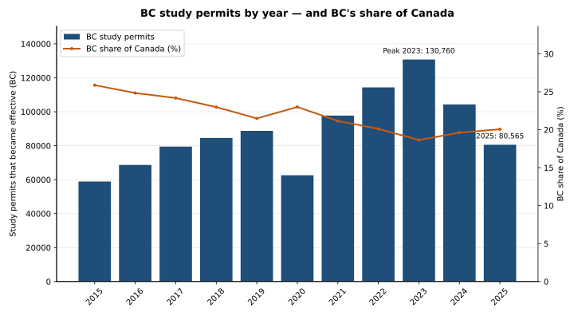
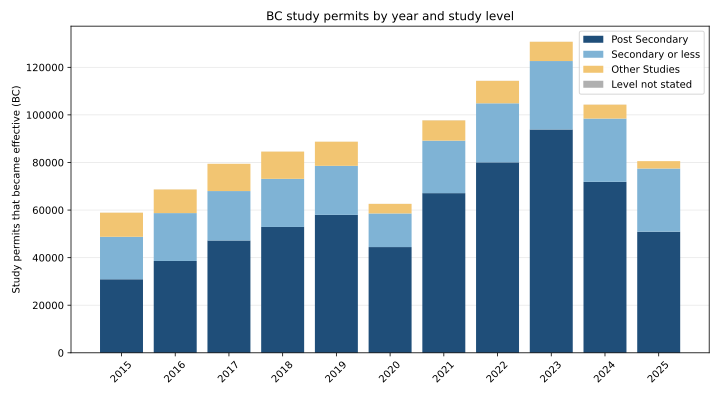
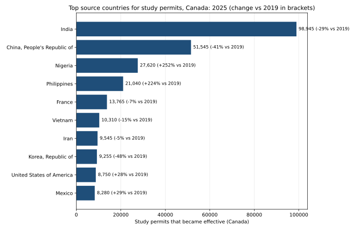
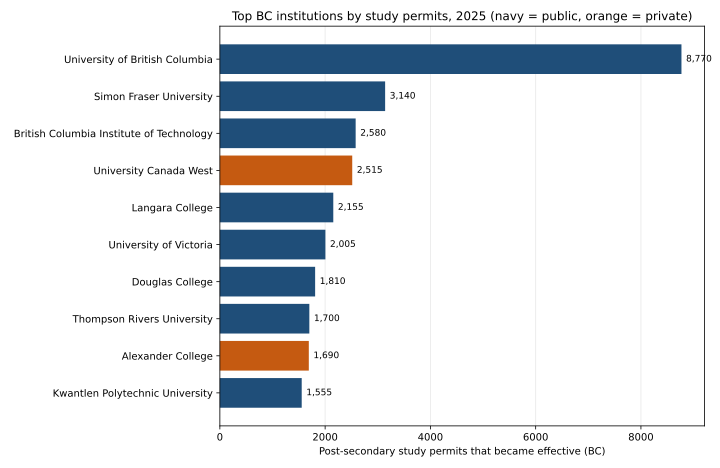

# International study permits to BC

**Question: where do BC's international students come from, and how is that changing?**

This project answers it from Immigration, Refugees and Citizenship Canada
(IRCC) open data on study permits that became effective in each year.
These are flows — new permits taking effect — not the stock of students
already here.

## Executive summary



**BC's study-permit intake has fallen 38% from its 2023 peak — but BC's
share of Canada is rising again, and the students still arriving skew
younger, with secondary-school permits now a third of the intake.**

## Findings

### 1. BC's intake: a boom, then a sharp correction

| Year | BC permits | Change |
|------|-----------:|-------:|
| 2015 | 58,920 | — |
| 2019 | 88,755 | pre-pandemic high |
| 2020 | 62,620 | −29% (pandemic dip) |
| 2023 | 130,760 | peak |
| 2024 | 104,330 | −20% |
| 2025 | 80,565 | −38% from peak |

Even after the correction, 2025 is still 37% above 2015. The 2023 peak was
more than double the 2015 intake.

### 2. The mix shifted: post-secondary fell hardest, secondary held up



- Post-secondary was 71.8% of BC permits at the 2023 peak, but only 63.2%
  in 2025 (50,890 permits).
- Secondary-or-less barely fell in absolute terms (28,750 in 2023 to
  26,565 in 2025), so its share jumped from 22.0% to 33.0% of BC's intake.
- "Other Studies" collapsed, from 8,110 to 3,110.

The post-2023 decline is concentrated in post-secondary and other studies;
the secondary-school stream proved far more resilient.

### 3. BC's share of Canada fell, then recovered

BC took 25.9% of Canada's study permits in 2015, slid to 18.6% at the 2023
peak, and recovered to 20.1% in 2025. In other words, BC's intake fell
38% from peak — but the rest of Canada fell faster.

### 4. Who is coming to Canada: the giants shrank, Nigeria and the Philippines surged



IRCC's country file has no province split, so this lens is Canada-wide
(see Limitations). In 2025:

| Country | Permits (Canada) | Share | Change vs 2019 |
|---------|-----------------:|------:|---------------:|
| India | 98,945 | 24.7% | −29% |
| China, People's Republic of | 51,545 | 12.9% | −41% |
| Nigeria | 27,620 | 6.9% | +252% |
| Philippines | 21,040 | 5.3% | +224% |
| France | 13,765 | 3.4% | −7% |
| Vietnam | 10,310 | 2.6% | −15% |
| Iran | 9,545 | 2.4% | −5% |
| Korea, Republic of | 9,255 | 2.3% | −48% |
| United States of America | 8,750 | 2.2% | +28% |
| Mexico | 8,280 | 2.1% | +29% |

The top 3 countries still account for 44.5% of Canada's permits, but the
mix is diversifying: India and China are both well below their 2019
levels, while Nigeria and the Philippines have more than tripled.

### 5. Which BC institutions draw the most permits



Post-secondary permits by designated learning institution, 2025:

| Institution | Permits | Public / Private |
|-------------|--------:|------------------|
| University of British Columbia | 8,770 | Public |
| Simon Fraser University | 3,140 | Public |
| British Columbia Institute of Technology | 2,580 | Public |
| University Canada West | 2,515 | Private |
| Langara College | 2,155 | Public |
| University of Victoria | 2,005 | Public |
| Douglas College | 1,810 | Public |
| Thompson Rivers University | 1,700 | Public |
| Alexander College | 1,690 | Private |
| Kwantlen Polytechnic University | 1,555 | Public |

UBC alone draws more than the next two combined. The top 10 account for
27,920 permits — 54.9% of BC's post-secondary total. Eight of the top 10
are public institutions.

### 6. Permits lead enrolments — read the two projects together

A companion project in this portfolio tracks BC post-secondary
*enrolments* (the stock of students enrolled). BC international
enrolments peaked in 2023/24 (78,885) and fell 6.3% in 2024/25. Permits
(the flow of new arrivals) peaked in 2023 and fell 38% by 2025. Because
permits lead enrolments, the enrolment decline is likely to deepen as
the smaller permit cohorts work through the system.

## How to run

```bash
pip install -r requirements.txt
python analysis.py   # downloads the IRCC CSVs, prints findings, writes data/ and charts/
pytest               # 7 tests: parsing, aggregation, and regression checks
```

Raw IRCC downloads land in the repo root (git-ignored); the filtered
tables below are committed.

## Data dictionary

**`data/bc_permits_by_year.csv`** — one row per complete year (2015–2025).

- `year`, `total` — all BC study permits that became effective that year.
- `post_secondary`, `secondary_or_less`, `other_studies`,
  `level_not_stated` — the same total split by IRCC study level.
- `post_secondary_share_pct` — post-secondary share of the BC total.
- `bc_share_of_canada_pct` — BC's share of the Canada total that year
  (Canada total includes "Province/territory not stated" rows).

**`data/canada_top_countries.csv`** — top 10 source countries for Canada.

- `permits_latest` (2025), `permits_baseline` (2019), `share_latest_pct`,
  `change_pct` (2025 vs 2019).

**`data/bc_top_institutions.csv`** — top 10 BC designated learning
institutions by post-secondary permits in 2025, with public/private
(`admin_type`).

## Limitations — read before citing

- **Permits are not students.** The files count permits that became
  effective, including renewals and extensions. One student can appear
  more than once over time, and a permit holder may not enrol.
- **Rounding and suppression.** IRCC rounds values to the nearest 5 and
  suppresses values from 0 to 5 as `--`. Suppressed cells are excluded
  from sums here (never counted as zero), so totals slightly understate
  the true counts, and rounded components may not sum exactly to totals.
- **2026 is excluded.** The latest year in the file is partial (only
  part of the year published so far); only complete years 2015–2025 are
  analysed.
- **"Post Secondary" lumps colleges and universities together** in the
  province file. The institution file splits post-secondary by named
  institution but covers post-secondary only.
- **No province-by-country split exists in IRCC's current files.**
  Countries are therefore shown for Canada as a whole, and BC is shown
  by study level and by institution instead. IRCC does publish archived
  province-by-country tables, but on an older stock concept; they are
  not mixed into this flow-based analysis.
- **Source:** Immigration, Refugees and Citizenship Canada, "Temporary
  Residents: Study Permit Holders – Monthly IRCC Updates" (Open
  Government Licence – Canada).
- **Licence:** see `LICENSE` (CC BY-NC 4.0 — academic demonstration
  only, no commercial use).
